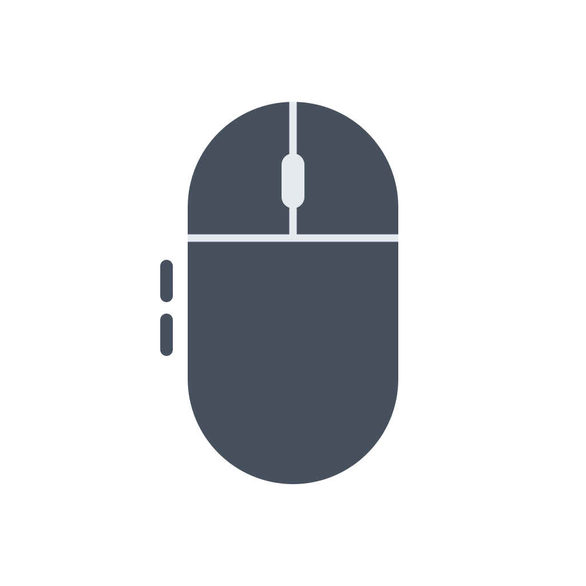

<p align="center">
  
</p>

<h1 align="center">MacMouse</h1>

<p align="center">Personalizza i pulsanti e lo scorrimento del tuo mouse su Mac.</p>

<p align="center">
  <a href="https://github.com/andrelombardo/MacMouse/releases/latest">Scarica MacMouse</a>
</p>

Assegna ai tasti laterali le azioni che usi ogni giorno e inverti la rotella senza cambiare lo scorrimento del trackpad. MacMouse usa i controlli nativi di macOS, conserva le impostazioni sul Mac e continua a funzionare quando chiudi la finestra.

L’icona compare nel Dock quando apri la finestra. Il pulsante rosso chiude la finestra e nasconde l’icona dal Dock, lasciando attive le azioni del mouse in background. Per terminare l’app usa **Esci da MacMouse**.

Gratuita e offline, senza account, pubblicità o telemetria. Richiede **macOS 27 o successivo** e un Mac con **Apple Silicon**.

## Per iniziare

1. Scarica il **DMG** dalle [Release](https://github.com/andrelombardo/MacMouse/releases/latest) e aprilo.
2. Trascina **MacMouse** nella cartella **Applicazioni** della finestra, poi apri l’app da Applicazioni.
3. Premi **Apri le impostazioni**, consenti Accessibilità a MacMouse e torna nell’app.

Per usare lo scorrimento naturale sul trackpad e quello tradizionale sul mouse, lascia **Scorrimento naturale** attivo nelle impostazioni di macOS e abilita **Inverti scorrimento del mouse** in MacMouse.

## Cosa puoi fare

- **Vedere il modello collegato:** sotto il nome compare il modello comunicato dal mouse, solo se disponibile e diverso dal nome. Si aggiorna automaticamente quando cambi dispositivo.
- **Personalizzare due pulsanti:** Indietro, Avanti, Mission Control, cambio scrivania, apertura di app e scorciatoie.
- **Gestire la rotella:** inversione verticale e orizzontale, mantenendo velocità e precisione.
- **Usare il clic centrale:** anche con trascinamento, oppure conservare o disabilitare l’azione di un pulsante.
- **Avviare al login:** tramite il servizio nativo di macOS.
- **Nascondere l’icona:** dalla finestra dell’app. Quando è visibile, il menu contiene soltanto **Apri MacMouse** ed **Esci da MacMouse**. Puoi sempre riaprire l’app da Applicazioni.

Le associazioni valgono per tutti i mouse che inviano lo stesso numero di pulsante. L’inversione riguarda le rotelle con eventi a scatti; trackpad, gesti e inerzia passano invariati. I mouse che inviano scorrimento continuo, come Magic Mouse o alcuni driver con scorrimento fluido, mantengono la direzione di sistema.

## Permessi e risorse

Accessibilità consente la rimappatura e l’invio delle scorciatoie. MacMouse non registra la tastiera: una combinazione viene acquisita soltanto nel campo di registrazione. Il rilevamento locale di un pulsante funziona anche prima del consenso; le azioni nelle altre app richiedono l’autorizzazione.

Il motore attende gli eventi, senza polling o timer periodici. Lo scorrimento viene intercettato solo quando l’inversione è attiva. Chiudendo la finestra viene liberata la sua interfaccia. Gli oggetti temporanei del filtro vengono rilasciati dopo ogni evento.

Le build senza Developer ID e notarizzazione possono richiedere l’approvazione in **Impostazioni di Sistema → Privacy e sicurezza**, secondo la [procedura Apple](https://support.apple.com/it-it/102445). Un aggiornamento può richiedere di concedere di nuovo Accessibilità alla copia in Applicazioni.

## Sviluppo

Apri `MacMouse.xcodeproj` con Xcode 27, oppure usa Swift 6.4 con SDK macOS 27:

```sh
git clone https://github.com/andrelombardo/MacMouse.git
cd MacMouse
scripts/build.sh
scripts/package.sh
```

| Comando | Risultato |
| --- | --- |
| `scripts/build.sh` | Crea `build/MacMouse.app`. |
| `scripts/package.sh` | Crea DMG, ZIP e checksum in `dist/`. |
| `scripts/install-local.sh` | Compila e installa in Applicazioni, conservando preferenze e un backup della copia precedente. |

L’app non ha dipendenze esterne. Solo il packaging richiede Python 3.10+ e i tool fissati in `scripts/requirements-packaging.txt`, installati in un ambiente isolato. Se necessario, specifica il percorso dell’interprete con `PYTHON=/percorso/python3 scripts/package.sh`. La pipeline compila il progetto Xcode in Release e verifica bundle, archivi e checksum.

Per pubblicare un aggiornamento, aumenta `CFBundleShortVersionString` e `CFBundleVersion` in `Sources/MacMouse/Resources/Info.plist`, aggiorna `docs/RELEASE_NOTES.md` e fai push su `main`: dopo le verifiche GitHub crea automaticamente il tag e la nuova Release con DMG, ZIP e checksum. Le versioni già pubblicate vengono conservate. È possibile avviare il rilascio anche pubblicando un tag `vX.Y.Z` corrispondente alla versione dell’app.

## Licenza

[MIT](LICENSE). Codice e icona originali; simboli di sistema forniti da macOS.
