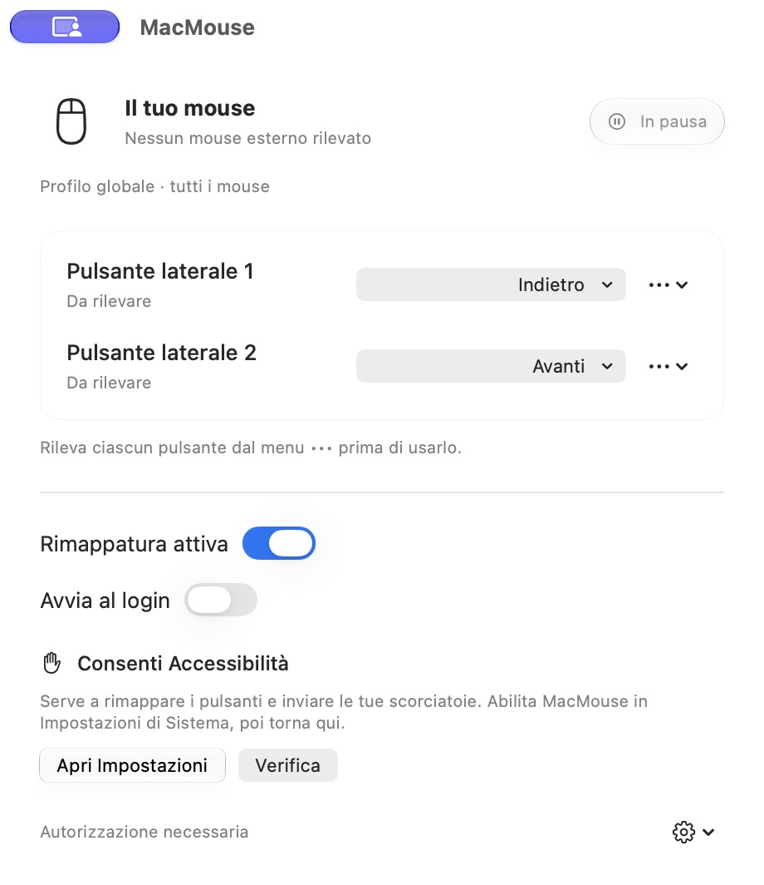

# MacMouse

A lightweight native macOS app for customizing your mouse.

MacMouse associa i pulsanti aggiuntivi del mouse alle azioni che usi ogni giorno. Una finestra compatta in SwiftUI, controlli Liquid Glass e un menu nella barra di macOS. Gratuita, interamente offline, senza account, telemetria o dipendenze esterne.

<picture>
  <source media="(prefers-color-scheme: dark)" srcset="docs/images/macmouse-dark.png">
  
</picture>

Screenshot reale della beta su macOS 27, prima della concessione di Accessibilità e del collegamento di un mouse.


Il nuovo rilevamento mostra il pulsante premuto e permette di confermare esplicitamente l’associazione.

## Funzionalità

- Due pulsanti configurabili, riconosciuti in un pop-up **Rileva pulsante** con anteprima e conferma, senza codici prestabiliti.
- Indietro e Avanti, cambio scrivania a sinistra/destra, azioni macOS, apertura di applicazioni e scorciatoie personalizzate.
- Clic centrale con trascinamento, disattivazione e comportamento originale.
- Scorciatoie con Command, Shift, Option, Control e tasti funzione.
- Impostazioni locali persistenti; funzionamento continuo a finestra chiusa.
- Avvio al login tramite ServiceManagement e diagnostica su richiesta.

Il profilo è **globale**: gli eventi Quartz non identificano in modo affidabile il mouse di origine. IOKit mostra i mouse enumerati e le variazioni di connessione, senza attribuire loro gli eventi globali. Le associazioni valgono per tutti i dispositivi con lo stesso numero di pulsante. Clic sinistro, clic destro, puntatore, scorrimento e gesti standard del trackpad non vengono rimappati.

## Compatibilità

macOS **27 o successivo**, **Apple Silicon**. Build arm64 compilata su macOS 27.0.1 con Swift 6.4 e SDK macOS 27.0. Il progetto Xcode richiede Xcode 27; sul Mac di sviluppo sono presenti i Command Line Tools, senza Xcode completo. Il progetto Xcode è stato compilato con successo anche nella [pipeline](https://github.com/andrelombardo/MacMouse/actions).

Il dispositivo di riferimento è il **TECKNET TK-MS317**, via Bluetooth o ricevitore USB. **La verifica fisica del dispositivo non è stata eseguita**: la prima versione è una beta. Non è distribuita una build Intel.

## Download

[Scarica MacMouse 0.1.3 beta 1](https://github.com/andrelombardo/MacMouse/releases/tag/v0.1.3-beta.1).

Scegli `MacMouse-v0.1.3-macOS.zip` oppure `MacMouse-v0.1.3-macOS.dmg`. `SHA256SUMS.txt` contiene i checksum degli archivi. Le [Release](https://github.com/andrelombardo/MacMouse/releases) sono l’unico canale di aggiornamento; l’app non effettua richieste di rete.

## Installazione

1. Estrai lo ZIP, oppure apri il DMG.
2. Copia **MacMouse.app** in **Applicazioni** e aprila da quella posizione.
3. In **Privacy e sicurezza → Controllo del dispositivo e accesso ai dati** concedi l’autorizzazione alla copia installata, quindi scegli **Verifica**.
4. Premi **Rileva pulsante** sotto la prima riga. Nel pop-up porta il puntatore nel riquadro, prova il tasto laterale e premi **Conferma**. Puoi ripetere la prova o scegliere un numero già rilevato prima di salvare. Ripeti con la seconda riga.
5. Scegli le azioni; puoi chiudere la finestra e riaprirla dall’icona del mouse nella barra dei menu.

Per cambiare scrivania crea prima almeno due spazi in Mission Control, poi scegli **Scrivania a sinistra** e **Scrivania a destra** nella sezione macOS del menu azioni. Usano Control–← e Control–→ senza doverle registrare: macOS può intercettare queste combinazioni durante la registrazione. Le rispettive scorciatoie devono essere abilitate nelle impostazioni della tastiera. Con una sola scrivania, o al limite della sequenza di spazi, la relativa direzione non produce uno spostamento.

La beta ha una **firma ad hoc**, senza **Developer ID** e senza **notarizzazione**. Gatekeeper può bloccarne l’apertura. Se ti fidi della provenienza, usa la procedura di approvazione offerta da macOS in **Impostazioni di Sistema → Privacy e sicurezza → Apri comunque**, quando disponibile. Su un Mac gestito questa scelta può essere vietata. Non occorre disabilitare Gatekeeper né rimuovere attributi di sicurezza. In alternativa compila il codice localmente. Vedi la [procedura Apple](https://support.apple.com/it-it/102445).

## Autorizzazioni

**Accessibilità** serve al filtro attivo dei pulsanti e all’invio delle scorciatoie. MacMouse legge i menu dell’app in primo piano solo quando richiedi Indietro o Avanti. La registrazione di una scorciatoia avviene esclusivamente nel campo dedicato della finestra; il motore globale ascolta solo gli eventi dei pulsanti aggiuntivi del mouse.

Il consenso al controllo del dispositivo e quello all’invio degli eventi vengono verificati separatamente. Il pop-up può rilevare i pulsanti dentro il riquadro anche senza autorizzazione globale; questo non abilita la rimappatura in altre app. **Annulla** conserva l’associazione precedente e non vengono salvati eventi o cronologie.

Una firma ad hoc cambia identità fra compilazioni. Se l’interruttore è acceso ma il consenso non viene riconosciuto, esci dall’app, rimuovi la vecchia voce e riaggiungi la copia in Applicazioni. Se macOS conserva ancora la vecchia identità, riavvia il Mac. Il comando **Mostra app** individua esattamente il bundle in uso. Non occorre modificare TCC, Gatekeeper o altri servizi di sicurezza.

Monitoraggio input non viene richiesto preventivamente. Se, dopo aver concesso Accessibilità, macOS rifiuta ancora l’event tap, compare il relativo comando opzionale. Il servizio HID enumera i dispositivi senza aprirli o leggere report di input. Nessun accesso a rete, microfono o registrazione dello schermo.

Per Indietro/Avanti viene cercata un’azione di menu abilitata in italiano o inglese, dando priorità ai menu di navigazione. In Safari e Finder, in mancanza del menu, viene tentata la scorciatoia Command–parentesi quadra se il layout la espone. Negli altri casi assegna una scorciatoia personalizzata: una combinazione di navigazione non viene inviata indiscriminatamente alle altre app. Le azioni Mission Control, App Exposé e Mostra scrivania usano rispettivamente Control–↑, Control–↓ e F11: devono essere abilitate nelle impostazioni della tastiera. Dal menu **•••** puoi modificarle. Cambio applicazione invia un singolo Command–Tab; Cambio finestra richiede una combinazione disponibile nel layout attivo o una registrazione personalizzata. Launchpad / Applicazioni richiede sempre la scorciatoia configurata dall’utente; non vengono usate API private.

## Compilazione dal sorgente

Apri `MacMouse.xcodeproj` in Xcode 27, seleziona **MacMouse → My Mac** e compila. I test sono nel package Swift: apri `Package.swift` in Xcode per eseguirli, oppure usa gli script seguenti con Xcode o i Command Line Tools 27:

```sh
scripts/test.sh
scripts/build.sh
scripts/package.sh
```

L’app si trova in `build/MacMouse.app`; ZIP, DMG e checksum in `dist/`. Non sono richiesti gestori di pacchetti o dipendenze di terze parti. `scripts/generate-icon.swift` rigenera gli asset originali tramite AppKit; `scripts/generate-project.py` rigenera il progetto Xcode dai sorgenti.

Per l’uso sul proprio Mac, dopo aver chiuso MacMouse, `scripts/install-local.sh` compila e installa un bundle completo in Applicazioni. Usa un certificato Developer ID o Apple Development già disponibile nel keychain, se presente, senza esportare chiavi. La firma Apple Development è destinata all’uso locale: la Release pubblica viene prodotta separatamente dalla pipeline. L’installazione conserva preferenze e stato del login, salva un backup ZIP della copia precedente e non concede autorizzazioni automaticamente.

La pipeline usa un runner Apple Silicon con Xcode 27, esegue test e build Release sia del progetto Xcode sia del package, quindi conserva gli archivi. Sui tag pubblica una Release solo dopo la riuscita della build. Firma Developer ID e notarizzazione sono opzionali, configurabili esclusivamente tramite GitHub Secrets. La compilazione automatica non certifica i test fisici del mouse.

Consulta [verifiche e limiti](docs/VALIDATION.md), [test manuali](docs/MANUAL_TESTS.md), [note tecniche](docs/ARCHITECTURE.md) e [procedura di rilascio](docs/RELEASING.md).

## Licenza

[MIT](LICENSE). Codice e geometria dell’icona originali. I simboli di sistema sono forniti da macOS.
